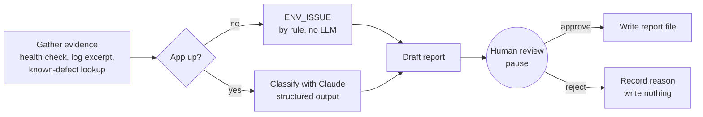

# AI QA Toolkit

Three AI tools for test teams, each with a human in control and tests that prove it:

| Tool | What it does | Human control |
|---|---|---|
| [**Test case generator**](#1-test-case-generator) | Turns a user story into structured, technique-tagged test cases; scores coverage; exports CSV for Jira/Zephyr/ADO | Output is measured against a hand-written must-have list, and ambiguities come back as questions for the BA |
| [**QA tools MCP server**](#2-qa-tools-mcp-server) | Lets Claude Code / Claude Desktop run allow-listed test suites and read failures and defect reports | Allow-list only, no shell, validated ids, read-only otherwise |
| [**Defect investigation agent**](#3-defect-investigation-agent) | LangGraph agent that investigates a failed test, classifies it and drafts a report | Pauses for approval; nothing is written unless a person approves |

[](https://github.com/Neelima-Gunduboina/ai-qa-toolkit/actions/workflows/ci.yml)   

Works with my Java/TestNG banking framework [qa-portfolio-parabank](https://github.com/Neelima-Gunduboina/qa-portfolio-parabank).

## Setup

```bash
python -m venv .venv && source .venv/bin/activate
pip install -e ".[dev]"
pytest                       # 28 offline tests, no API key needed
export ANTHROPIC_API_KEY=... # for the live tools
```

The model defaults to `claude-opus-5-5`; set `LLM_MODEL` to use another.

---

## 1. Test case generator

Writing test cases from user stories is slow, and coverage depends on who writes them. The generator drafts them, and the toolkit **measures** the draft instead of trusting it.

```bash
python -m ai_qa_toolkit.testgen stories/fund-transfer.md \
    --must-have stories/fund-transfer.must-have.yaml --csv out/fund-transfer.csv
```

- **Structured output:** Claude must return the `TestSuite` schema (id, title, technique, priority, negative flag, preconditions, steps, expected result). The CLI validates it before anything is printed or exported.
- **Coverage score:** recall against 12 must-have scenarios an experienced tester would expect for the story (boundaries at £0.01, £25,000.00 and £25,000.01, same account, insufficient funds, balances unchanged on failure, and so on).
- **Quality checks:** duplicate ids, missing negative cases, empty steps, vague expected results.
- **Open questions:** the model is told to list ambiguities instead of guessing.

**Found while building it:** the first version of the coverage scorer counted "£25,000.01" as covering the "£0.01" scenario (substring match). There's now a regression test for it.

## 2. QA tools MCP server

[MCP](https://modelcontextprotocol.io) is the standard way to give AI assistants tools. This server exposes a Java/TestNG repository:

| Tool | Does | Safety |
|---|---|---|
| `list_test_suites` | Lists the suites it may run | Read-only |
| `run_suite(name)` | Runs an allow-listed Maven profile and returns pass/fail + last 30 lines | Allow-list, no shell, 15-min timeout |
| `get_failures()` | Failed tests from the last run's Surefire XML | Read-only |
| `get_defect(defect_id)` | Text of a defect report, e.g. DEF-001 | Id must match `DEF-NNN` (blocks path traversal) |

Connect it to Claude Code:

```bash
claude mcp add qa-tools -e QA_REPO=/path/to/qa-portfolio-parabank -- /path/to/ai-qa-toolkit/.venv/bin/python -m ai_qa_toolkit.mcp_server
```

Then ask: *"Run the api-db suite, list any failures, and check whether they match a known defect."*

## 3. Defect investigation agent

Triage of failed CI runs eats QA time. This agent investigates with read-only tools and drafts a report, but **a person decides**.



Categories: `REAL_BUG`, `FLAKY`, `LOCATOR_DRIFT`, `ENV_ISSUE`, `TEST_BUG`.

```bash
python -m ai_qa_toolkit.defect_agent investigate F-06   # shows the draft, asks you to approve
python -m ai_qa_toolkit.defect_agent eval               # accuracy on 10 recorded failures
```

The 10 recorded failures include three real defects from my ParaBank framework (DEF-001, DEF-004, DEF-005), plus typical environment outages, locator drift, flaky timing and a test bug (a `BigDecimal` scale mismatch).

**What the agent may never do:** file tickets, rerun or change tests, change code, or write anything without approval. Tests prove that rejection writes nothing and that an app outage is classified without calling the LLM.

## Results

| Tool | Measure | Result |
|---|---|---|
| Test case generator | Coverage of 12 must-have scenarios for FT-101 | Run live and fill in |
| Defect agent | Correct category on 10 recorded failures | Run live and fill in |

## Project structure

```
src/ai_qa_toolkit/
  testgen/        models (schema), generator, review (coverage, quality, CSV), CLI
  mcp_server/     server with 4 tools + safety rules
  defect_agent/   tools, LangGraph graph with human approval, CLI, recorded failures
stories/          sample banking user story + must-have scenarios
tests/            28 offline tests (fake LLM client; MCP tools called in-process)
```

## Limitations

- Coverage scoring uses keywords, so a correct case worded differently can be missed. Misses are listed for a person to check.
- 10 recorded failures is a small evaluation set. It shows the method, not a production accuracy figure.
- The MCP server runs whatever the allow-listed Maven profiles run; keep that list short.

## Author

**Neelima Gunduboina**, QA Engineer (banking and insurance), ISTQB CTFL · [LinkedIn](https://www.linkedin.com/in/neelimagunduboina/)

## License

MIT
