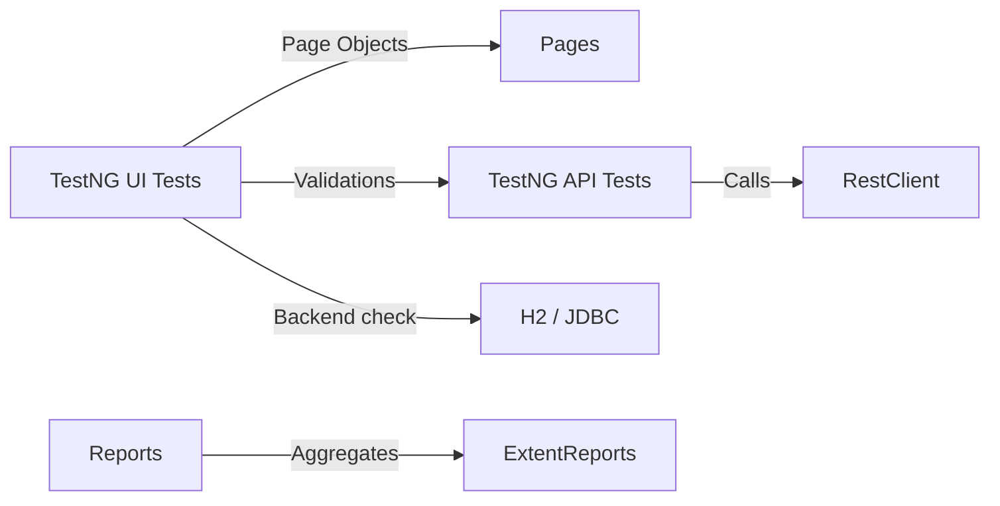

# QA Automation Portfolio — ParaBank (Java, Selenium, REST Assured, H2)

This repository is a polished automation framework demonstrating UI, API and DB testing using the exact stack on my resume.

**Project snapshot**
- Language: Java 17 (Maven)
- UI: Selenium WebDriver 4 + Page Object Model + PageFactory
- Test Runner: TestNG
- API: REST Assured
- DB: JDBC with H2 (in-memory) / optional MySQL
- Reporting: ExtentReports + TestNG reports
- Logging: Log4j2
- CI: GitHub Actions (runs `smoke` on push)

**Repository structure**

qa-portfolio-parabank/
- pom.xml
- .gitignore
- README.md
- src/main/java/
  - pages/ (Page Objects)
  - utils/ (Config, DB utils, waits, reporting helpers)
  - api/clients/ (REST clients)
- src/test/java/
  - base/ (BaseTest with ThreadLocal WebDriver)
  - listeners/ (TestNG listeners for reporting/screenshots)
  - tests/ui/ (UI tests)
  - tests/api/ (API tests)
  - tests/db/ (DB tests)
- src/test/resources/
  - config-qa.properties, config-staging.properties
  - testng.xml, smoke.xml, regression.xml
  - testdata/ (JSON test data)

**Architecture (mermaid)**



Overview
- UI tests target the public ParaBank demo UI (https://parabank.parasoft.com). Tests use POM + PageFactory, explicit waits, and encapsulated assertions.
- API tests use REST Assured against a stable demo API (configurable via properties). By default `api.base.url` points to Restful-Booker as a fallback.
- DB tests use an embedded H2 instance to demonstrate JDBC validation and SQL-based checks. Note: full DB-level validation of Parabank's backend requires access to their DB; this project demonstrates the same approach using an embedded DB to mirror backend assertions.

Key features
- Thread-safe WebDriver via `ThreadLocal<WebDriver>` in `BaseTest` for parallel runs.
- TestNG groups and suites: smoke, regression and full suites.
- Data-driven tests via TestNG `@DataProvider` reading JSON test data.
- ExtentReports HTML output in `reports/` with screenshots on failures.
- Config driven via `config-qa.properties` and `config-staging.properties` and Maven profiles for env switching.

Quick start

Prerequisites
- Java 17
- Maven 3.6+
- Chrome browser (tests use ChromeDriver via WebDriverManager)

Run the smoke suite (default QA config):

```bash
mvn test -Psmoke
```

Run regression (longer):

```bash
mvn test -Pregression
```

To explicitly choose env (optional):

```bash
mvn test -Psmoke -Denv=qa
# or
mvn test -Psmoke -Denv=staging
```

Reports
- Extent report: `reports/extent-report.html` (artifact uploaded by CI)
- Screenshots: `reports/screenshots/`

Security / credentials
- No credentials are stored in the repository. Config values like passwords should be supplied via environment variables or CI secrets. `ConfigLoader` reads `-Denv=` and loads `config-<env>.properties`.

Skills demonstrated (mapping to resume)

- UI automation: Selenium WebDriver (POM + PageFactory), explicit waits, stable locators
- API testing: REST Assured (status codes, body/schema assertions, chained workflows)
- DB validation: JDBC + SQL assertions against an H2 schema (mirrors backend verification)
- CI/CD: GitHub Actions running headless tests and publishing artifacts
- Reporting: ExtentReports with screenshots and TestNG integration
- Design: Thread-safe test base, data-driven tests, clear package separation

Suggested GitHub repo name

`neelima-qa-portfolio-parabank`

Suggested repo description (paste into GitHub)

"Java 17 Test Automation framework (Selenium, TestNG, REST Assured, JDBC) showcasing end-to-end UI, API and DB validations against public demo apps. CI-ready with GitHub Actions and rich HTML reporting."

---

Next steps: I will now create every file (source, tests, resources, CI workflow) under the project folder.
