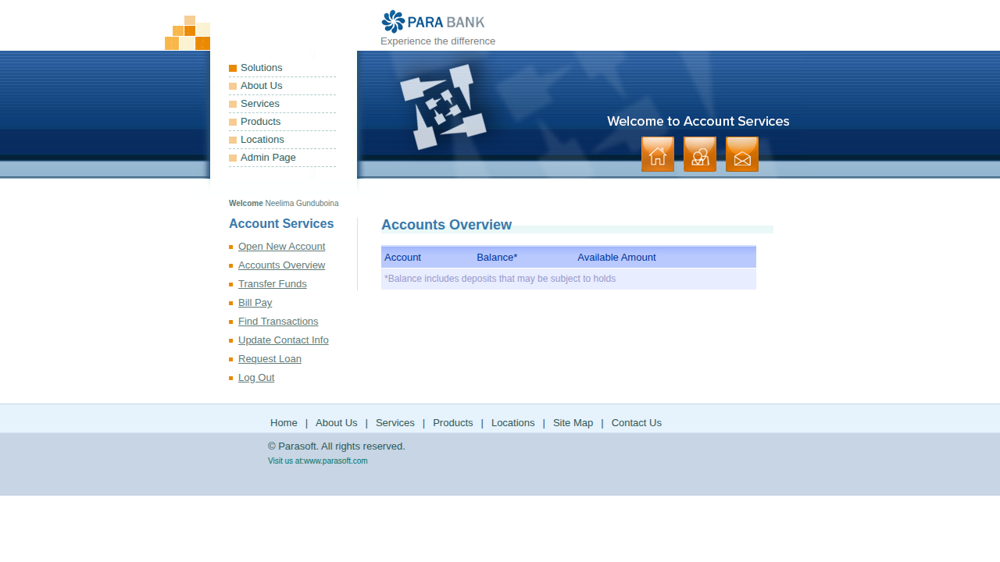
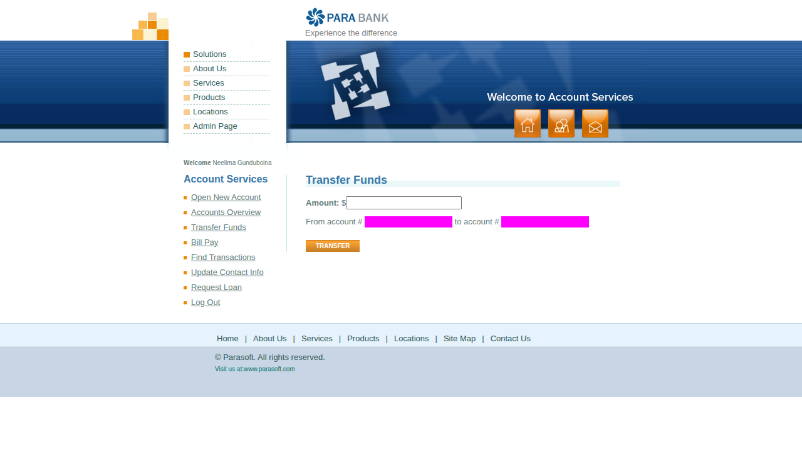
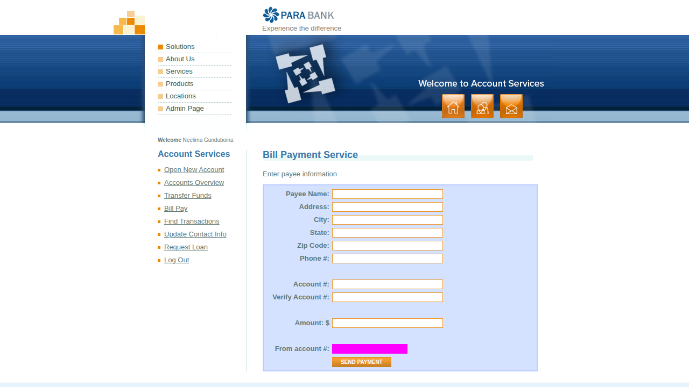

# AI-Powered Banking QA Portfolio

> **Playwright + TypeScript test automation framework with GenAI capabilities** —
> self-healing locators, LLM-driven test generation, AI failure triage, and
> Playwright MCP browser control. Built against ParaBank, a public banking demo
> that mirrors real-world fund transfer, bill payment, and account management flows.

[](https://github.com/Neelima-Gunduboina/qa-engineering-portfolio/actions/workflows/ai-banking-qa-portfolio.yml)
[](https://www.typescriptlang.org/)
[](https://playwright.dev/)
[](LICENSE)

---

## About This Project

I am a QA Engineer with **4+ years of manual testing experience** in:
- **Banking** — Citi Bank, Oracle FLEXCUBE core banking: fund transfers, payments, SWIFT messaging, account management, maker-checker
- **Insurance** — Royal London: migration and release testing, policy lifecycle, contribution processing, API testing with Postman

This portfolio project demonstrates that I can **both write solid automation AND apply
GenAI tooling intelligently** — not as a buzzword, but as a practical force-multiplier
with clear human oversight at every step.

---

## GenAI Features

| Feature | Implementation | What It Proves |
|---------|---------------|----------------|
| **Self-Healing Locators** | `utils/self-heal.ts`, proven in `tests/ui/self-heal.spec.ts` | Opt-in helper: when a selector breaks, the LLM proposes a new one from the ARIA snapshot; accepted only if it matches exactly one element, and disabled in CI by default |
| **AI Test Generation** | `scripts/generate-tests.ts` | Accelerates test design from requirements; human review gate before CI inclusion |
| **LLM Failure Triage** | `scripts/triage.ts` | Classifies failures (real bug / flaky / locator drift / env issue) in CI; reduces manual triage time |
| **Playwright MCP** | `docs/mcp-setup.md` | Natural-language → browser action execution via Claude; accessibility-tree-driven |
| **Visual Regression** | `tests/visual/` | Screenshot baseline comparison; catches layout regressions missed by functional tests |
| **Accessibility Testing** | `tests/a11y/` | WCAG 2.1 AA checks via axe-core; regulatory requirement in UK financial services |

> **Every GenAI feature has a documented human-in-the-loop safeguard.** AI accelerates;
> QA judgement is the quality gate. See [docs/ai-in-qa.md](docs/ai-in-qa.md).

---

## Mapping to Banking / Insurance QA Experience

| Test Coverage | Maps to Real-World Experience |
|--------------|-------------------------------|
| Fund transfer (UI + API) | FLEXCUBE fund transfers and payments: debit/credit and balance checks |
| Negative and boundary input | Invalid-input, special-character and field validation on transaction screens |
| Accounts overview | Account management screens; SQL backend validation of balances |
| API tests | API testing with Postman at Royal London: status codes, valid/invalid input, error handling |
| End-to-end flows | Maker-checker and end-to-end transaction testing across environments |

---

## Tech Stack

| Category | Technology |
|----------|-----------|
| Language | TypeScript 5.9 / Node 22 |
| Test framework | Playwright Test 1.65 |
| Pattern | Page Object Model + typed fixtures |
| API testing | Playwright `APIRequestContext` (built-in) |
| Visual testing | Playwright `toHaveScreenshot` |
| Accessibility | `@axe-core/playwright` |
| AI / LLM | Anthropic SDK (`claude-sonnet-5-5`, configurable via `LLM_MODEL`) |
| Reporting | Playwright HTML report + JSON |
| CI/CD | GitHub Actions (4 parallel shards) |

---

## Project Structure

```
ai-banking-qa-portfolio/
├── tests/
│   ├── auth.setup.ts          # Shared auth state (login once, reuse across tests)
│   ├── ui/                    # Functional browser tests
│   │   ├── login.spec.ts
│   │   ├── dashboard.spec.ts
│   │   ├── transfer.spec.ts
│   │   ├── billpay.spec.ts
│   │   ├── register.spec.ts
│   │   └── ai-generated/      # LLM drafts, human-reviewed
│   ├── api/                   # REST API tests
│   ├── visual/                # Screenshot baselines
│   └── a11y/                  # Accessibility checks
├── pages/                     # Typed Page Object classes
├── fixtures/                  # Custom Playwright fixtures + test data
├── utils/
│   ├── llm-client.ts          # Anthropic SDK wrapper (shared by all GenAI features)
│   ├── self-heal.ts           # Self-healing locator utility
│   └── logger.ts
├── scripts/
│   ├── generate-tests.ts      # AI test generation from requirements
│   └── triage.ts              # CI failure classification
├── requirements/              # Plain-English user stories (input for AI gen)
├── docs/                      # Architecture, MCP setup, AI feature guide
└── (CI: ../.github/workflows/ai-banking-qa-portfolio.yml at the portfolio root)
```

---

## Quick Start

### Prerequisites
- Node.js 20+
- Git

### Setup

```bash
# 1. Clone the repository
git clone https://github.com/Neelima-Gunduboina/ai-banking-qa-portfolio.git
cd ai-banking-qa-portfolio

# 2. Install dependencies
npm install

# 3. Install Playwright browsers
npx playwright install --with-deps

# 4. Configure environment
cp .env.example .env
# Nothing to fill in for the core suite: the setup step registers a fresh
# ParaBank customer for each run. Optionally set PARABANK_USERNAME/PASSWORD
# to use an existing customer, and ANTHROPIC_API_KEY for the GenAI features.
```

### Running Tests

```bash
# All tests (chromium, firefox, webkit, API, visual, a11y)
npm test

# UI tests only
npm run test:ui

# API tests only
npm run test:api

# Visual regression
npm run test:visual

# Accessibility checks
npm run test:a11y

# Headed mode (watch the browser)
npm run test:headed

# Debug a specific test
npm run test:debug -- --grep "TC-L-01"

# View HTML report
npm run test:report
```

### GenAI Features (requires ANTHROPIC_API_KEY in .env)

```bash
# Generate test cases from a requirements file
npm run generate-tests -- --req requirements/REQ-001-login.md

# Generate for all requirements
npm run generate-tests -- --all

# Run AI failure triage on last test results
npm run triage
```

> **Without an API key:** All core tests run normally. GenAI features log a
> warning and skip gracefully — zero test failures caused by missing LLM config.

---

## CI Pipeline

The GitHub Actions workflow ([`.github/workflows/ai-banking-qa-portfolio.yml`](../.github/workflows/ai-banking-qa-portfolio.yml) at the portfolio root) runs:

1. **TypeScript type check** — fast gate, fails immediately on type errors
2. **Sharded test run** — 4 parallel runners, each executing 1/4 of the test suite
3. **Report merge** — combines shard results into a single HTML report artifact
4. **AI failure triage** — classifies failures and posts to the Actions job summary
5. **API-only job** — runs REST tests without browser install overhead

Artifacts retained per run:
- `playwright-report/` (HTML) — 30 days
- `test-results/*.zip` (traces) — 7 days (on failure only)
- `test-results/triage.json` — 14 days

---

## Screenshots

These are the committed visual-regression baselines (Chromium on Linux, the same images CI compares against).
Dynamic content such as balances and the news date is masked.

| Login | Accounts Overview |
|---|---|
|  |  |

| Transfer Funds | Bill Pay |
|---|---|
|  |  |

---

## Findings

Running this suite against the live demo surfaced real issues, each covered by a test:

| Finding | Where | Test |
|---|---|---|
| **DEF-001**: transfer API accepts a negative amount | API | `TC-API-T-04` (`test.fail`, expected to fail until fixed) |
| **DEF-004**: a $0.00 transfer (and a transfer to the same account) completes | UI + API | `TC-T-03` (`test.fail`) |
| **DEF-005**: a new username over 20 characters is rejected as "already exists" | UI | `TC-R-05` (`test.fail`) |
| **7 WCAG 2.1 AA issues**, e.g. unlabelled login fields and account dropdowns | All pages | `tests/a11y` (baseline; fails only on *new* issues) |

Full defect reports live in the companion repo [qa-portfolio-parabank/docs/defects](https://github.com/Neelima-Gunduboina/qa-portfolio-parabank/tree/main/docs/defects);
the accessibility audit is in [docs/accessibility-findings.md](docs/accessibility-findings.md).

`test.fail()` is Playwright's way to mark a known bug: CI stays green while the bug is open, and the test reports
"unexpectedly passed" the moment it is fixed, so the marker gets removed instead of forgotten.

---

## Security Notes

- **No credentials are committed to this repository.** Each run registers its own throwaway ParaBank customer (`tests/auth.setup.ts`); an existing one can be supplied via environment variables.
- **`.env` is gitignored.** Copy `.env.example` to `.env` locally — never commit `.env`.
- **API keys are GitHub Secrets** in CI (`ANTHROPIC_API_KEY`). The suite runs without them.
- **Storage state and generated credentials** (`playwright/.auth/*.json`) are gitignored — they contain session tokens.
- No real banking credentials, PII, or production systems are used anywhere in this project.

---

## Documentation

| Document | Contents |
|---------|---------|
| [docs/architecture.md](docs/architecture.md) | System architecture with Mermaid diagram |
| [docs/ai-in-qa.md](docs/ai-in-qa.md) | Deep-dive on each GenAI feature + human oversight |
| [docs/mcp-setup.md](docs/mcp-setup.md) | Playwright MCP configuration for Claude |
| [docs/accessibility-findings.md](docs/accessibility-findings.md) | WCAG 2.1 AA audit of ParaBank with suggested fixes |

---

## Author

**Neelima Gunduboina**  
ISTQB Certified | 4+ Years QA | Banking (FLEXCUBE) & Insurance (Royal London)  
[LinkedIn](https://www.linkedin.com/in/neelimagunduboina/) · [Companion Java framework (Selenium + REST Assured + SQL)](https://github.com/Neelima-Gunduboina/qa-portfolio-parabank)

---

## License

MIT — see [LICENSE](LICENSE)
