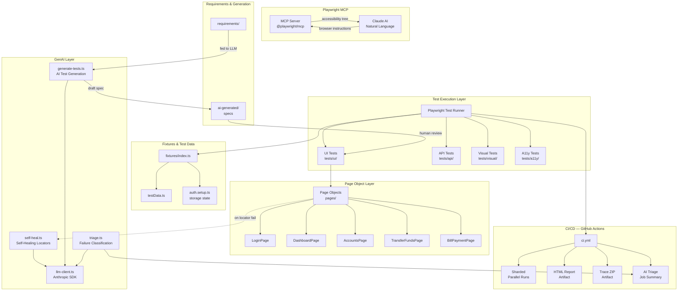

# Framework Architecture

## Overview

This framework wraps a standard Playwright + TypeScript test suite with a
deliberately minimal but production-realistic GenAI layer. Every AI feature
degrades gracefully — the core regression suite runs without any API key.

---

## System Architecture



---

## Directory Structure

```
ai-banking-qa-portfolio/
├── tests/
│   ├── auth.setup.ts          # One-time login → storage state
│   ├── ui/                    # Functional UI tests (POM-based)
│   │   ├── login.spec.ts
│   │   ├── dashboard.spec.ts
│   │   ├── transfer.spec.ts
│   │   ├── billpay.spec.ts
│   │   ├── register.spec.ts
│   │   └── ai-generated/      # LLM-generated drafts, human-reviewed
│   ├── api/                   # REST API tests (APIRequestContext)
│   │   ├── accounts.spec.ts
│   │   ├── transfer.spec.ts
│   │   └── customers.spec.ts
│   ├── visual/                # Screenshot regression
│   │   └── snapshots.spec.ts
│   └── a11y/                  # Axe-core WCAG checks
│       └── accessibility.spec.ts
├── pages/                     # Page Object Model classes
├── fixtures/                  # Playwright fixture extensions + test data
├── utils/
│   ├── llm-client.ts          # Anthropic SDK wrapper (shared)
│   ├── self-heal.ts           # Intent-based self-healing locators
│   └── logger.ts              # Structured logger
├── scripts/
│   ├── generate-tests.ts      # AI test generation from requirements
│   └── triage.ts              # LLM failure classification
├── requirements/              # Plain-English user stories (input for AI gen)
├── docs/                      # This documentation
└── (CI: ../.github/workflows/ai-banking-qa-portfolio.yml at the portfolio root)
```

---

## GenAI Feature Map

| Feature | File | Trigger | Degrades Without Key |
|---------|------|---------|----------------------|
| Self-healing locators | `utils/self-heal.ts` | Locator not found (off in CI unless `SELF_HEAL=on`) | Falls back to original selector |
| AI test generation | `scripts/generate-tests.ts` | Manual `npm run generate-tests` | Logs warning, exits 0 |
| Failure triage | `scripts/triage.ts` | Post-CI via GitHub Actions | Reports "UNKNOWN" category |
| MCP browser control | `@playwright/mcp` | Manual / Claude session | Not in CI pipeline |

---

## Authentication Strategy

```
auth.setup.ts
    │
    ├─► page.goto('/parabank/index.htm')
    ├─► page.fill(username), page.fill(password), page.click(login)
    ├─► page.context().storageState({ path: 'playwright/.auth/user.json' })
    │
    └─► All other test projects read storageState on startup
        (no repeated logins — O(1) auth cost per test run)
```

The `playwright/.auth/` directory is **gitignored** — storage state files contain
session tokens. CI regenerates them fresh on each run via the `setup` project.

---

## Parallel Execution & Sharding

```yaml
# GitHub Actions matrix (ci.yml)
strategy:
  matrix:
    shard: [1, 2, 3, 4]

# Each runner executes:
playwright test --shard=${{ matrix.shard }}/4
```

Playwright distributes test files evenly across shards. With 4 shards, a
60-test suite runs in ~1/4 the wall-clock time. Results are merged and a
single HTML report is published.

---

## Technology Decisions

| Decision | Rationale |
|----------|-----------|
| Playwright over Selenium/Cypress | Auto-waiting, trace viewer, parallel + cross-browser, built-in API testing |
| TypeScript over JavaScript | Type safety catches selector typos and wrong return types at compile time |
| Anthropic SDK direct (no LangChain) | Minimal dependencies, explicit control over prompts, easier to debug |
| axe-core for a11y | Industry standard, integrates natively with Playwright, maps to WCAG 2.1 |
| Storage state auth | Faster than re-logging in per test; mirrors real-world SSO session reuse |
| Graceful LLM degradation | Suite must be CI-green without secrets — onboarding friction killer |
